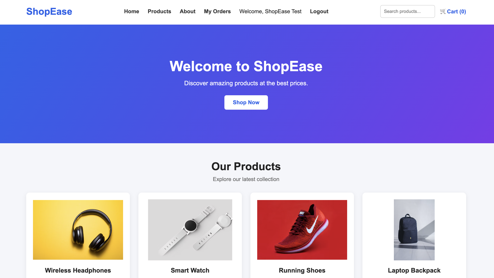
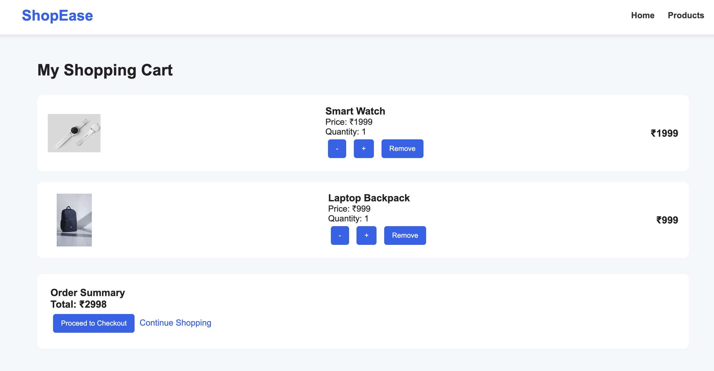
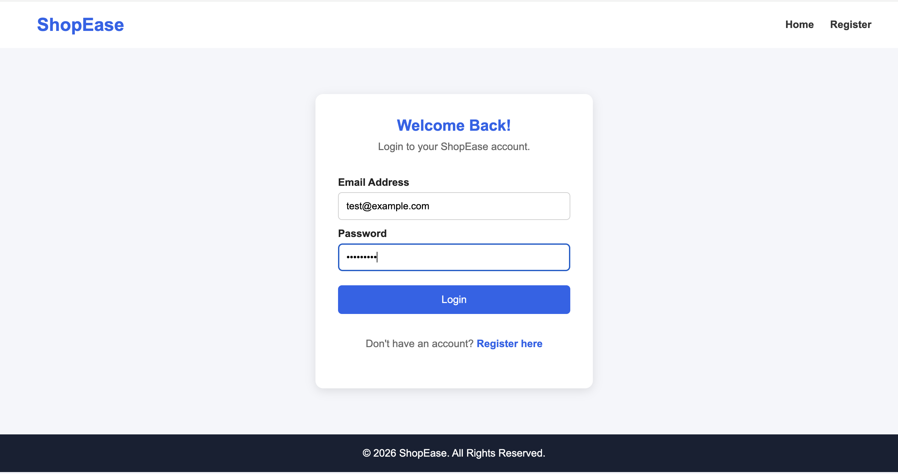
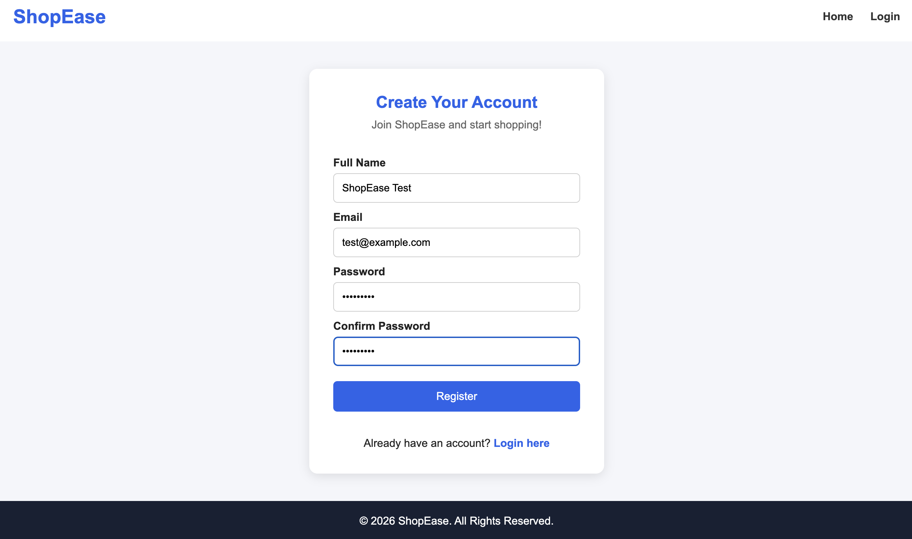
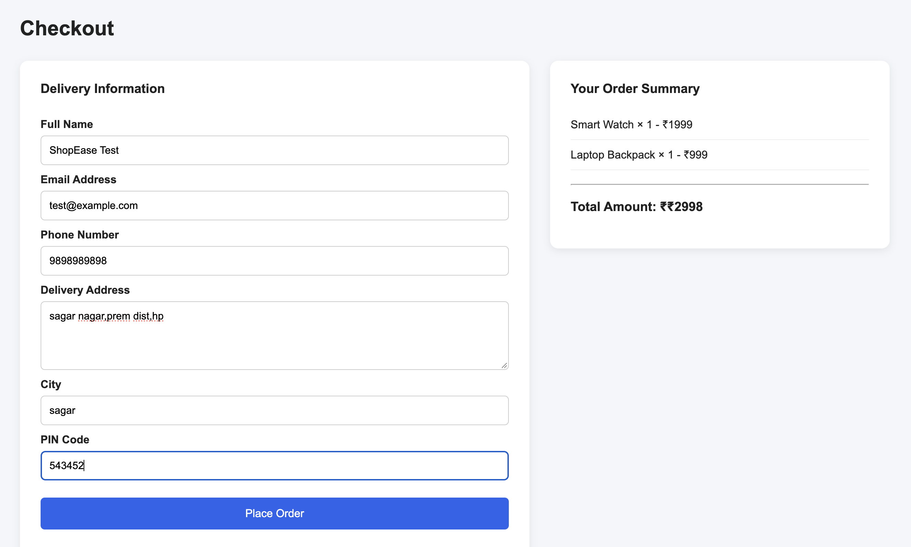
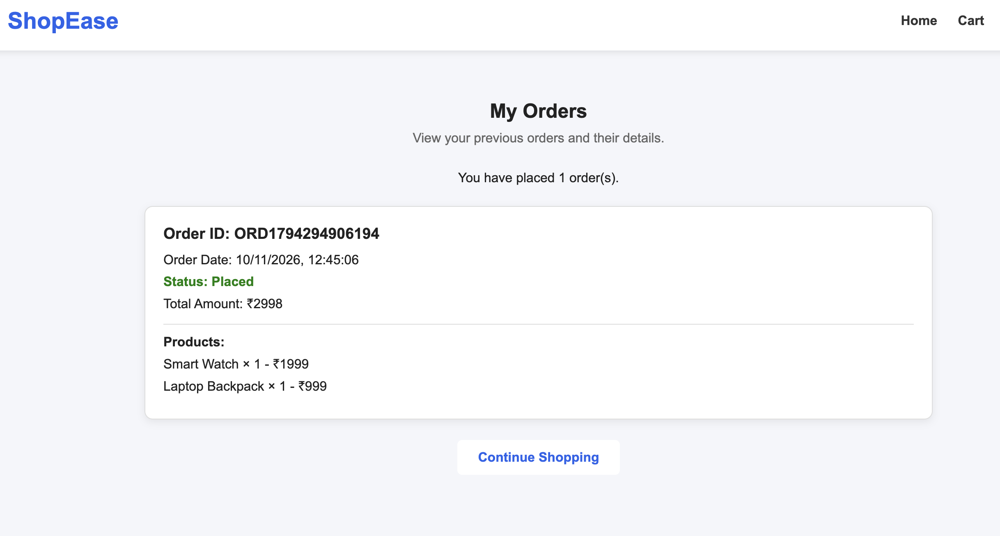

# ShopEase – Full Stack E-commerce Website

## Project Overview
ShopEase is a full-stack e-commerce website developed as part of the CodeAlpha Internship. It allows users to browse products, register, log in, add products to a shopping cart, place orders, and view their order history.

## Features
- Product listing with images
- Product search
- Product details
- Shopping cart and quantity management
- User registration and login
- Secure password hashing
- JWT-based authentication
- Checkout and order placement
- Order confirmation
- My Orders page
- MongoDB database integration

## Technologies Used

**Frontend**
- HTML
- CSS
- JavaScript

**Backend**
- Node.js
- Express.js
- MongoDB
- Mongoose
- JSON Web Token (JWT)
- bcryptjs

## Project Structure

```text
CodeAlpha_EcommerceStore/
├── backend/
│   ├── models/
│   ├── routes/
│   ├── server.js
│   └── package.json
├── frontend/
│   ├── index.html
│   ├── style.css
│   ├── script.js
│   ├── cart.html
│   ├── checkout.html
│   ├── login.html
│   └── register.html
└── .gitignore
```

## How to Run the Project

### 1. Clone the repository

```bash
git clone https://github.com/kotaashwik06-hub/CodeAlpha_EcommerceStore.git
```

### 2. Install backend dependencies

```bash
cd CodeAlpha_EcommerceStore/backend
npm install
```

### 3. Configure environment variables

Create a `.env` file inside the backend folder:

```env
PORT=5001
MONGODB_URI=your_mongodb_connection_string
JWT_SECRET=your_secret_key
```

Use your own MongoDB connection string and a secure JWT secret. Never publish these credentials.

### 4. Start the backend

```bash
npm run dev
```

### 5. Run the frontend

Open the `frontend` folder in Visual Studio Code and launch `index.html` using the Live Server extension.

## Database
MongoDB Atlas is used to store user accounts and customer orders.

## Author
Developed as part of the CodeAlpha Internship.

## Repository
https://github.com/kotaashwik06-hub/CodeAlpha_EcommerceStore


## Project Screenshots

### 1. Homepage


### 2. Shopping Cart


### 3. Login


### 4. Registration


### 5. Checkout


### 6. My Orders

